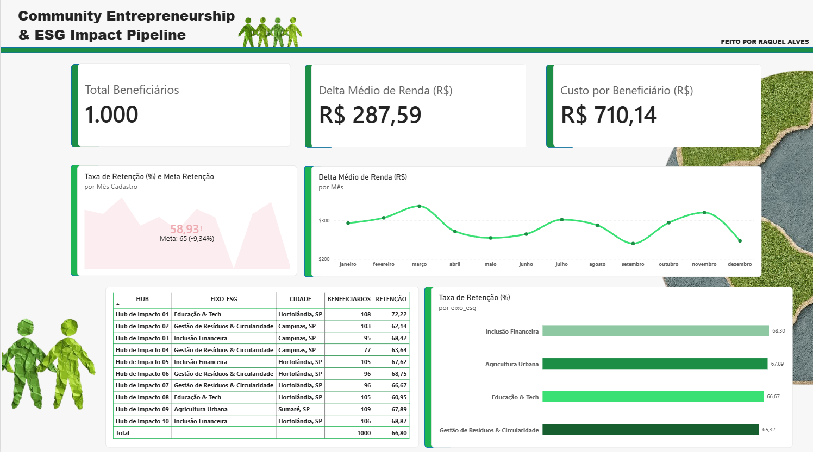
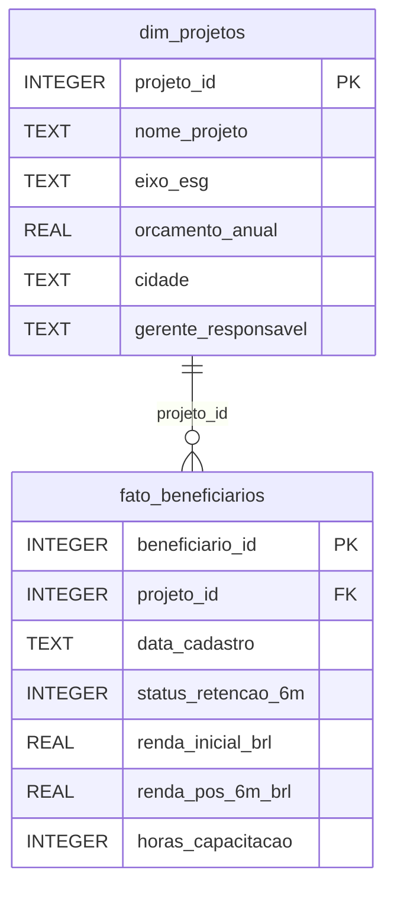

# ESG Impact Pipeline — Community Entrepreneurship Analytics

Pipeline de dados e dashboard executivo para medir o **impacto social** de projetos comunitários (estilo Enactus): retenção em capacitação, ganho de renda, custo por beneficiário e indicadores por eixo ESG.



> **Aviso:** os dados deste projeto são **sintéticos**, gerados em Python com semente fixa (`seed=42`) para demonstrar a metodologia. Não representam resultados reais de nenhum programa.

---

## Problema de negócio

Projetos de impacto social costumam reportar números soltos (pessoas atendidas, horas dadas) e têm dificuldade de responder perguntas de decisão:

- Quanto custa, em média, cada beneficiário atendido?
- Quantos permanecem no programa após 6 meses?
- Qual o ganho de renda de quem conclui?
- Mais orçamento significa mais retenção?

Este projeto transforma essas métricas "intangíveis" em um modelo de dados relacional e em um dashboard orientado a decisão.

## Resultados no dataset simulado

| Indicador | Valor |
|---|---|
| Beneficiários cadastrados (2025) | 1.000 |
| Hubs de impacto | 10 |
| Taxa de retenção em 6 meses | 66,8% |
| Delta médio de renda (base total) | R$ 287,59 |
| Delta médio de renda (apenas retidos) | R$ 430,53 |
| Orçamento anual somado | R$ 710.143,63 |
| Custo por beneficiário | R$ 710,14 |
| Custo por beneficiário retido | R$ 1.063,09 |

**Retenção por eixo ESG**

| Eixo | Beneficiários | Retenção |
|---|---|---|
| Inclusão Financeira | 306 | 68,30% |
| Agricultura Urbana | 109 | 67,89% |
| Educação & Tech | 213 | 66,67% |
| Gestão de Resíduos & Circularidade | 372 | 65,32% |

### Leituras do dashboard

- **Orçamento maior não garantiu retenção maior.** Os 3 hubs com maior custo por beneficiário (Hubs 04, 06 e 09, entre R$ 1.107 e R$ 1.176) retiveram em média ~66,8%; os 3 de menor custo (Hubs 01, 03 e 10, entre R$ 394 e R$ 455) retiveram ~69,8%. A correlação entre orçamento e retenção nos 10 hubs é fraca (r ≈ -0,17; amostra pequena).
- **Carga horária separa quem fica de quem sai.** Beneficiários com 45h ou mais de capacitação retiveram 83,8% (622 pessoas) contra 38,9% (378 pessoas) abaixo disso.
- **Cohort mensal:** a retenção por mês de cadastro oscila entre 58,2% (setembro) e 71,0% (março).

> Nota metodológica: no dataset sintético, a regra de retenção usa a carga horária como fator (ver `scripts/gerar_dados.py`). A relação com horas, portanto, é esperada por construção; o objetivo do projeto é mostrar como o pipeline expõe esse tipo de relação quando aplicado a dados reais.

## Stack

- **SQLite** — banco relacional local (modelo estrela)
- **Python** (`sqlite3`, `pandas`) — geração dos dados, validação e exportação para CSV
- **SQL** — views de agregação (`sql/views_agregacao.sql`)
- **Power BI** — modelagem, DAX e dashboard

## Arquitetura

```
gerar_dados.py ──► esg_impact.db (SQLite) ──► validar_exportar.py ──► data/*.csv ──► Power BI (.pbix)
                          │
                          └──► sql/views_agregacao.sql (views de agregação)
```

## Modelo de dados



## Dicionário de dados

### `dim_projetos` (10 linhas)

| Coluna | Tipo | Descrição |
|---|---|---|
| `projeto_id` | INTEGER (PK) | Identificador único do hub/projeto (1 a 10) |
| `nome_projeto` | TEXT | Nome do hub (ex.: Hub de Impacto 01) |
| `eixo_esg` | TEXT | Eixo temático: Educação & Tech, Gestão de Resíduos & Circularidade, Agricultura Urbana ou Inclusão Financeira |
| `orcamento_anual` | REAL | Orçamento anual do projeto em R$ |
| `cidade` | TEXT | Cidade onde o hub atua |
| `gerente_responsavel` | TEXT | Pessoa gestora do hub |

### `fato_beneficiarios` (1.000 linhas)

| Coluna | Tipo | Descrição |
|---|---|---|
| `beneficiario_id` | INTEGER (PK) | Identificador único do beneficiário |
| `projeto_id` | INTEGER (FK) | Projeto ao qual o beneficiário pertence (`dim_projetos.projeto_id`) |
| `data_cadastro` | TEXT (YYYY-MM-DD) | Data de entrada no programa (2025) |
| `status_retencao_6m` | INTEGER (0/1) | 1 = permaneceu após 6 meses; 0 = evadiu |
| `renda_inicial_brl` | REAL | Renda mensal no cadastro, em R$ |
| `renda_pos_6m_brl` | REAL | Renda mensal após 6 meses, em R$ (igual à inicial para quem evadiu) |
| `horas_capacitacao` | INTEGER | Carga horária acumulada: 15, 30, 45, 60 ou 90 |

## Medidas DAX (Power BI)

```dax
Total Beneficiários = COUNTROWS(fato_beneficiarios)

Total Retidos = SUM(fato_beneficiarios[status_retencao_6m])

Taxa de Retenção (%) = DIVIDE([Total Retidos], [Total Beneficiários], 0) * 100

Renda Inicial Média = AVERAGE(fato_beneficiarios[renda_inicial_brl])

Renda Pós 6m Média = AVERAGE(fato_beneficiarios[renda_pos_6m_brl])

Delta Médio de Renda (R$) = [Renda Pós 6m Média] - [Renda Inicial Média]

Delta Médio de Renda (Retidos) =
CALCULATE([Delta Médio de Renda (R$)], fato_beneficiarios[status_retencao_6m] = 1)

Custo por Beneficiário (R$) =
DIVIDE(SUM(dim_projetos[orcamento_anual]), [Total Beneficiários], 0)

Meta Retenção = 65
```

Coluna calculada usada no cohort mensal (em `fato_beneficiarios`):

```dax
Mês Cadastro = FORMAT(fato_beneficiarios[data_cadastro], "YYYY-MM")
```

## Estrutura do repositório

```
esg-impact-analytics/
├── README.md
├── ESG-PROJETO.pbix          # dashboard Power BI
├── esg_impact.db             # gerado por scripts/gerar_dados.py
├── data/
│   ├── dim_projetos.csv
│   └── fato_beneficiarios.csv
├── docs/
│   └── dashboard.png         # captura do dashboard
├── scripts/
│   ├── gerar_dados.py
│   └── validar_exportar.py
└── sql/
    └── views_agregacao.sql
```

## Como reproduzir

```bash
pip install pandas

cd scripts
python gerar_dados.py          # cria e popula ../esg_impact.db
python validar_exportar.py     # valida métricas e exporta ../data/*.csv
```

Views de agregação (opcional):

```bash
python -c "import sqlite3; c=sqlite3.connect('../esg_impact.db'); c.executescript(open('../sql/views_agregacao.sql', encoding='utf-8').read())"
```

No Power BI, importe os dois CSVs de `data/` e crie o relacionamento `dim_projetos[projeto_id]` 1 → N `fato_beneficiarios[projeto_id]`.

### Nota técnica: separador decimal na importação

Os CSVs usam **ponto** como separador decimal (padrão do `pandas`). Em um Windows configurado em português (Brasil), o Power BI pode interpretar o ponto como separador de milhar e inflar os valores em 100x. Para as colunas `renda_inicial_brl`, `renda_pos_6m_brl` e `orcamento_anual`, converta o tipo com **Alterar Tipo > Usando Localidade > Número Decimal > Inglês (Estados Unidos)**, aplicando a conversão uma única vez, direto sobre o texto original.

## Próximos passos

- Adicionar custo por beneficiário retido como KPI no dashboard
- Cohort em matriz (meses desde o cadastro) com tabela calculada
- Substituir os dados sintéticos por dados reais anonimizados de um projeto

## Autora

**Raquel Alves** — [LinkedIn](https://www.linkedin.com/in/SEU-PERFIL)
